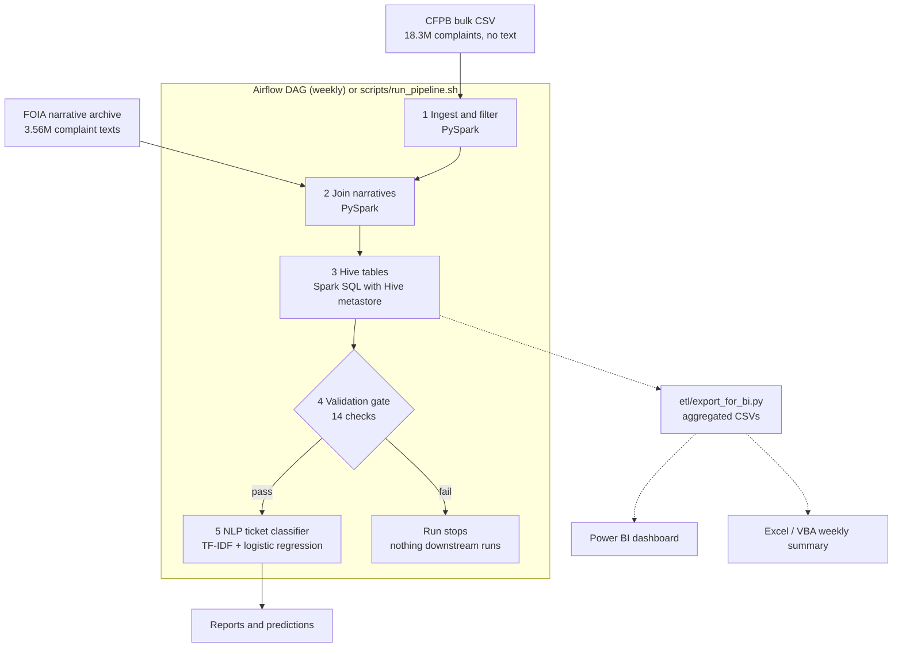
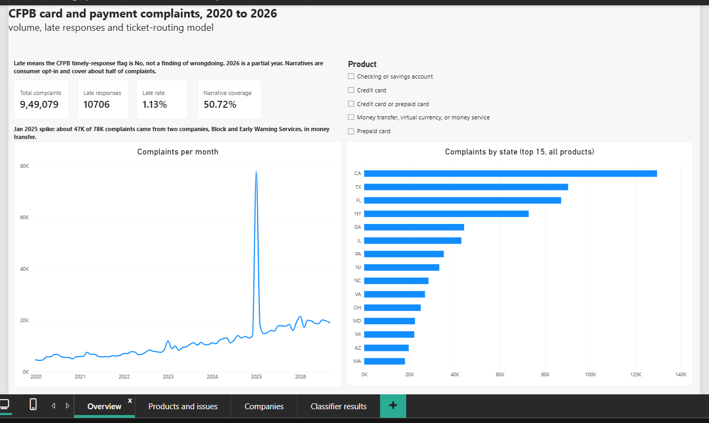
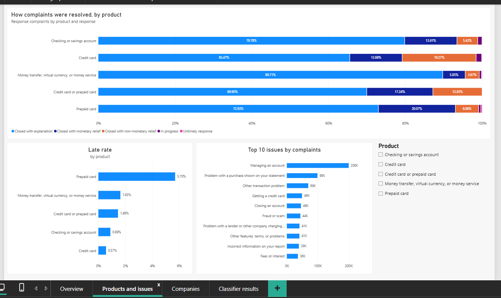
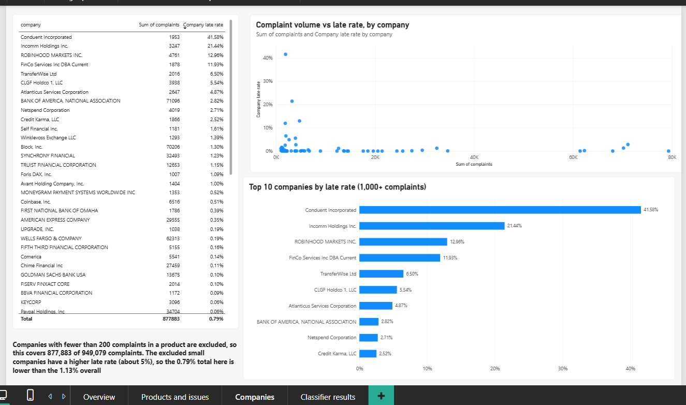
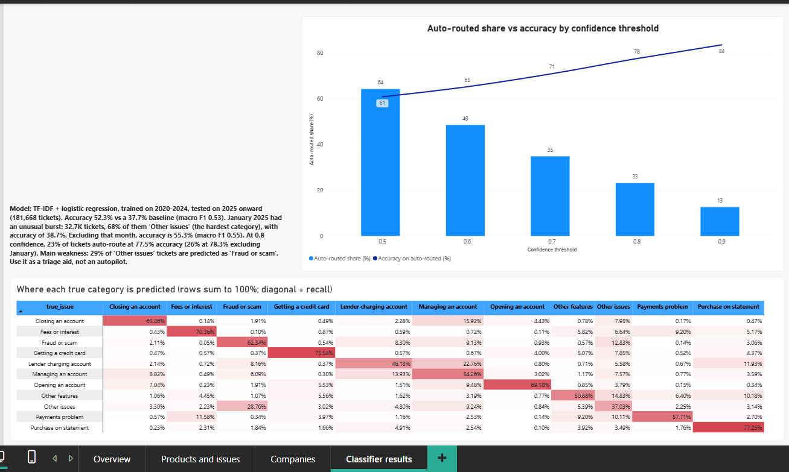

# SME Servicing Analytics Pipeline

An automated, end-to-end analytics pipeline on **real public data** (CFPB Consumer Complaint Database):
PySpark ingestion, Hive tables, automated data-quality gates, an NLP ticket-routing model, an Airflow
schedule, a Power BI dashboard and an Excel/VBA weekly-summary module.

The business framing is a financial-services servicing team: where do responses run late, can incoming
tickets be routed automatically, and can the whole reporting chain run without manual steps?

> **Status:** core pipeline, dashboard and impact analysis are done; the Excel/VBA summary module is written but not yet run end to end.
> Splunk log monitoring, Power Automate failure alerts and Confluence/SharePoint documentation are
> **planned, not implemented** (see [Roadmap](#roadmap)).

## Architecture



Solid arrows run automatically in the DAG. Dashed arrows are run on demand after a pipeline run.

## Data

| Source | Size | Notes |
|---|---|---|
| CFPB Consumer Complaint Database, bulk CSV | 18,346,245 rows | Product, issue, company, state, dates, timely-response flag. **No narrative text.** |
| CFPB FOIA narratives archive (exports 2-21, May 2018 to Aug 2026) | 3,558,968 unique narratives | The CFPB stopped publishing narratives in the live database on 14 Aug 2026, so text comes from this archive. |

After filtering to five card and payment products from 2020 onward and deduplicating on Complaint ID:
**949,079 complaints**, of which **481,385 (50.7%)** have a narrative. Narratives are consumer opt-in and
personal data is masked (XXXX), so the text subset is not a random sample of all complaints.

No data is stored in this repo. All data is public and re-downloadable (see [How to run](#how-to-run)).

## Pipeline stages

| Stage | Script | What it does | Measured runtime |
|---|---|---|---|
| 1 Ingest and filter | `etl/profile_cfpb.py` | Profiles the raw file, filters products and dates, dedupes, writes partitioned parquet | ~4 min |
| 2 Join narratives | `etl/build_narratives_layer.py` | Reads 20 archive CSVs, dedupes, joins to complaints on Complaint ID | ~1 min |
| 3 Hive tables | `etl/create_hive_tables.py` | Creates `sme_ops.complaints` and `sme_ops.ticket_narratives`, adds `sla_breach` and `days_to_company`, runs HiveQL analytics | ~20 s |
| 4 Validation gate | `etl/validate_data.py` | 14 automated checks (unique IDs, nulls, valid values, date ranges, orphan narratives). Exit code 1 on a critical failure | under 1 min |
| 5 NLP classifier | `etl/train_ticket_classifier.py` | Predicts the complaint Issue category from the narrative | ~7 min |

A full Airflow run (all five tasks) took **11 min 35 s** on a laptop (8 cores, ~24 GB RAM).
`scripts/run_pipeline.sh` runs the same chain from the shell with key=value event logging
(`logs/pipeline.log`), a lock file to prevent overlapping runs, and the same validation gate.

Hive note: tables are created through **Spark SQL with Hive support and a local Derby metastore**, not a
Hadoop cluster or a standalone HiveServer2.

## Results

### Late responses (CFPB "Timely response?" flag = No)
"Late" is the CFPB's timeliness flag. It is not a finding of wrongdoing.

| Product | Complaints | Late rate |
|---|---|---|
| Prepaid card | 19,778 | 5.70% |
| Money transfer, virtual currency, or money service | 180,231 | 1.63% |
| Credit card or prepaid card | 140,890 | 1.46% |
| Checking or savings account | 346,747 | 0.89% |
| Credit card | 261,433 | 0.57% |
| **All five products** | **949,079** | **1.13% (10,706 late)** |

Among companies with 1,000+ complaints, the highest late rates are at smaller prepaid and payment
providers; large banks are mostly below 3%. Per-company detail is on the dashboard's Companies page.

Complaint volume spiked in **January 2025** (about 78K in one month versus roughly 15K typical). About 47K of
those came from two companies in the money transfer product. The data does not say why.

### NLP ticket routing
Task: predict the Issue category (top 10 issues plus "Other issues") from the narrative.
Split by time: trained on 2020-2024 (254,473 tickets), tested on 2025 onward (181,668 tickets).

| Model | Accuracy | Macro F1 |
|---|---|---|
| Majority-class baseline | 37.7% | 0.050 |
| TF-IDF + logistic regression | 52.3% | 0.531 |
| Same model, excluding Jan 2025 | 55.3% | 0.549 |
| Same model, Jan 2025 only (32,746 tickets) | 38.7% | 0.468 |

Confidence threshold trade-off (auto-route when the model is confident, send the rest to a person):

| Threshold | Auto-routed | Accuracy on auto-routed |
|---|---|---|
| 0.5 | 64.2% | 60.8% |
| 0.6 | 48.5% | 65.2% |
| 0.7 | 34.8% | 70.9% |
| 0.8 | 23.1% | 77.5% |
| 0.9 | 12.6% | 83.5% |

January 2025 was 68% "Other issues", the hardest class (recall 37%), which is consistent with its lower accuracy.
The model is a **triage aid, not an autopilot**.

### Impact analysis (simulated)
**Measured:** at 0.8 confidence the classifier auto-routes 23.1% of tickets at 77.5% accuracy; the full
pipeline runs in 11.6 minutes.

**Assumed, not measured:** routing a ticket by hand takes 1 to 3 minutes; fixing a misrouted ticket takes 5
minutes; the weekly report takes 3 hours to build by hand. Ticket volume is the dataset's ~2,215
narrative-bearing complaints per week, not a real queue.

**Result under those assumptions:** net savings at the 0.8 threshold range from -1.1 to +16.0 hours per week
(1 to 3 minutes per ticket). Break-even is about 1.1 minutes of manual routing per ticket, so the model only
pays off where manual routing is slow relative to the cost of fixing a misroute. Reporting automation saves
about 2.8 simulated hours per week. Full table and the excluding-January sensitivity check:
`reports/impact_analysis.csv` (reproduce with `etl/impact_analysis.py`).

## Dashboard and Excel summary

Power BI report with four pages (`dashboard/SME_Servicing_Dashboard.pbix`, PDF export alongside).
Data comes from small aggregated CSVs produced by `etl/export_for_bi.py`.

| Overview | Products and issues |
|---|---|
|  |  |
| **Companies** | **Classifier results** |
|  |  |

`excel/WeeklySummary.bas` is a VBA module that imports `monthly_summary.csv`, builds a formula-driven summary
sheet (last 12 months vs prior 12 months by product), draws a chart and exports a dated PDF.

## Repo structure

```
etl/                    PySpark and scikit-learn stages, BI export, impact analysis
scripts/                run_pipeline.sh (shell runner), download_narratives.sh
airflow/dags/           sme_ops_pipeline_dag.py
excel/                  WeeklySummary.bas (VBA), workbook and PDF output (not yet added)
dashboard/              Power BI report and PDF export
reports/                data-quality report, classifier report, threshold table, BI CSVs, impact analysis
docs/screenshots/       dashboard screenshots
```

## How to run

Tested on Windows 11 with WSL2 (Ubuntu), Java 17 and a Python 3 virtual environment.

```bash
git clone https://github.com/sandeepsingh9871/sme-ops-pipeline.git
cd sme-ops-pipeline
sudo apt install -y openjdk-17-jdk wget unzip
python3 -m venv venv && source venv/bin/activate
pip install -r requirements.txt
mkdir -p data/raw
```

1. **Bulk file:** download "all complaint data (CSV ZIP)" from the CFPB complaint database page, unzip it, and
   place it at `data/raw/complaints.csv` (about 5 GB unzipped).
2. **Narratives:** `bash scripts/download_narratives.sh` (about 1.3 GB zipped, 8 GB unzipped). The file list was
   taken from the CFPB FOIA reading room page in Oct 2026 and may change.
3. **Run the pipeline:** `bash scripts/run_pipeline.sh` (add `--skip-train` to stop after validation).
4. **BI outputs:** `python etl/export_for_bi.py`, then point the Power BI report at `reports/bi/`.
5. **Impact analysis:** `python etl/impact_analysis.py`.

Optional Airflow schedule: install Airflow 3.1.8 in a separate Python 3.12 environment, put the DAG file in
your DAGs folder, and edit the `PROJECT` path at the top of `sme_ops_pipeline_dag.py` (it is set to
`/home/grimm/sme-ops-pipeline`). Only one run should be active at a time (`max_active_runs=1`): stages share
one local Derby metastore and write to the same output folders.

## Limitations

- Narratives exist for about half of complaints (consumer opt-in), so the classifier is trained on a self-selected subset.
- Issue labels are whatever the consumer selected, and several categories overlap, which caps achievable accuracy.
- The model leans on some brand names (for example "comenity", "edd") as shortcuts, so it may generalise worse to new companies.
- January 2025 is an unusual month and sits inside the test set; results are reported with and without it.
- The impact analysis is a simulation based on stated assumptions, not a measurement.
- Hive tables run through Spark's built-in Hive support, not a Hadoop cluster.
- 2026 is a partial year, and complaints still "In progress" can change their timely flag.

## Roadmap

- Splunk monitoring of `logs/pipeline.log` and `logs/dq_events.log` (the logs are already written as key=value / JSON lines)
- Power Automate alert on pipeline or validation failure
- Add Product as a model feature and compare against text-only
- Process documentation (Confluence or SharePoint) with a runbook
